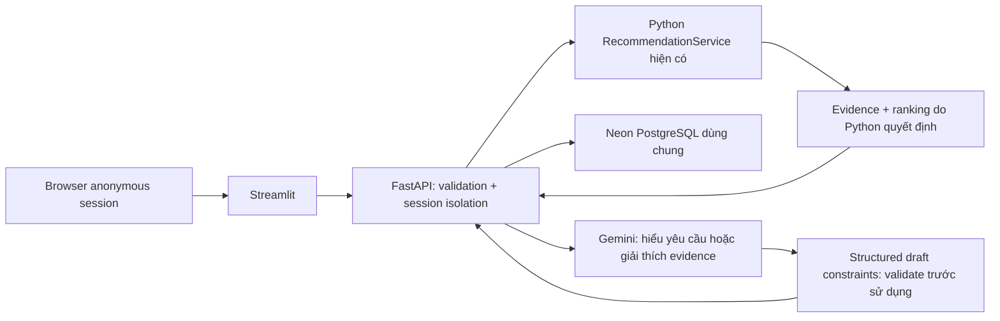
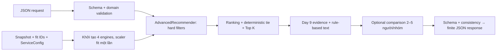
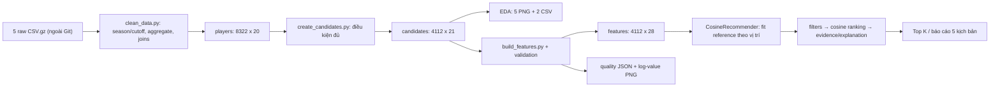
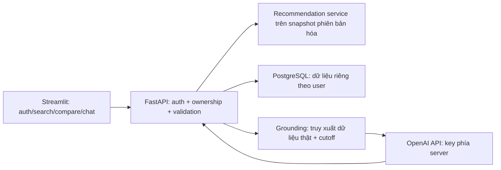

# ScoutIQ — Kiến trúc hiện có và đích đến

<!-- CHECKPOINT_20261108_START -->
## Bàn giao hiện hành — 2026-11-08

Nguồn tiếp tục cho Claude Code: [bàn giao tổng hợp Day1–13](CLAUDE_HANDOFF_2026-11-08.md). Mục này ưu tiên về trạng thái Git/bàn giao; các mục bên dưới là lịch sử được giữ nguyên. Người dùng đã yêu cầu commit/push checkpoint Day5–13 hôm nay; quyền này không áp dụng tự động cho Day14/deploy.

Day13 hoàn thành công cụ/tài liệu; chưa assessor/nhãn thật,32 pending, final relevance/ agreement bị chặn. Correction giữ PROPOSED, không đổi ranking/dataset. Latest full suite742 passed ngày06/11; checkpoint08/11 đối chiếu hash bản đã test, không tuyên bố chạy suite mới. Day14 FastAPI+Neon chưa triển khai; MVP không login/signup, Gemini chỉ hiểu yêu cầu/giải thích.

Tài liệu bàn giao ghi lịch sử/quyết định/roadmap,8 dataset và backup riêng,cách setup/kiểm hash/tests,limitations và prompt tiếp tục. `.gitattributes` giữ bytes để source/artifact hashes không đổi khi clone; docs/environment-checkpoint.json ghi môi trường quan sát mới, không phải lock. Commit chứa tài liệu bàn giao là checkpoint; tra hash và kiểm remote bằng lệnh trong tài liệu, không dùng các đoạn HEAD c4d638c/chưa commit lịch sử làm trạng thái hiện hành.
<!-- CHECKPOINT_20261108_END -->

<!-- DAY13_CURRENT_START -->
## Day 13 — 2026-11-06: pilot intake và review

**Hoàn thành phần công cụ local; pilot với người thật và final evaluation vẫn BLOCKED.** Người dùng xác nhận chưa có assessor/nhãn. Snapshot thật giữ nguyên: 32 pending, 0 graded, 0 assessor; relevance cuối null, agreement bị chặn. Correction Day12 vẫn PROPOSED/applied=false/approval=null; không đổi dữ liệu, ranking, scaler, eligibility hoặc API.

Thêm src/evaluation/review.py, run_day13.py và tests/test_day13_review.py. Runner kiểm hashes source/input frozen, tái dựng manifest seed12, nhập nhiều CSV + registry tường minh, từ chối trùng/version sai/SYNTHETIC; báo coverage missing/pending/abstain/uncertainty và queue bất đồng OPEN, không adjudicate. Output mới, không overwrite; giữ bản chấm thật ngoài repo và không sao chép free-text notes/evidence vào output. Registry cần review con người, không tự chứng minh độc lập.

Bằng chứng: reports/day13/summary.md, review.json, review_queue.json, validation.json; quy trình pilot_review_workflow.md, quyết định correction_decision.md, final_evaluation_plan.md và phase_review.md. Tests: **742 passed, 0 failed (762.99s; 717 cũ +25 mới)**; xem reports/day13/validation.json. Không có dependency mới.

Day14 dự kiến phần kỹ thuật FastAPI + Neon khi được giao; MVP anonymous không login/signup, Gemini phase sau chỉ hiểu yêu cầu/giải thích. Chưa production hoặc chất lượng scouting được nghiệm thu. Giữ blockers labels/temporal và correction deferred; không bịa nhãn để mở gate. Day1–12 bên dưới là lịch sử được bảo toàn.

Git main/HEAD c4d638c; chưa stage/commit/push. Checkpoint trước đã fetch và kiểm backup 8 datasets ở ngoài repo; archive trên cùng ổ C chưa là backup ngoài máy. Day13 thêm file nên danh sách stage 120 file trước đây cần rà lại khi làm Git.
<!-- DAY13_CURRENT_END -->

<!-- DAY12_CURRENT_START -->
## Bổ sung offline evaluation — Day 12

Không đổi RecommendationService, API JSON, engine/scaler/weights/eligibility. Thêm nhánh chỉ đọc: raw DOB + snapshot → [integrity.py](../src/evaluation/integrity.py) → age audit/coverage/exclusion/lineage + correction proposal; frozen Day 11 scenarios/evidence → [pilot.py](../src/evaluation/pilot.py) → sample tái lập + blank template → validation/provenance gates → readiness/conditional agreement. [Runner](../src/evaluation/run_day12.py) chỉ ghi thư mục mới; không có API apply correction hoặc promote service.

Contract pilot gồm dataset hash/rubric/scope/version, status pending/graded/abstain, uncertainty và missing evidence. Reader riêng giữ nguyên loader Day 11. Registry thật hiện rỗng; human gates yêu cầu review độc lập. Agreement theo scenario, exact và linear-weighted kappa; thiếu common labels hoặc mẫu số kỳ vọng bằng 0 trả blocked/null. [Guide](../reports/day12/pilot_annotation_guide.md), [temporal review](../reports/day12/temporal_leakage_review.md).

Correction đề xuất tách khỏi dataset/config production; chỉ kiểm tác động và promote khi được phép. [Lineage](../reports/day12/feature_lineage.csv) ghi nguồn/availability cho 28 cột; as-of metadata/publication time chưa đủ cho temporal evaluation. Web/Neon/Gemini/privacy browser bên dưới vẫn là kế hoạch.

### Kiến trúc các mốc trước — lịch sử

<!-- DAY12_CURRENT_END -->

<!-- DAY11_CURRENT_START -->
## Kiến trúc hiện hành và đích MVP mới — Day 11

**Phạm vi hiện hành do người dùng đổi ngày 2026-11-03:** MVP không login/signup. Người dùng tìm/lọc/xếp hạng/giải thích/so sánh cầu thủ và có lịch sử tìm kiếm ẩn danh theo trình duyệt. Stack đích: Streamlit, FastAPI, Neon PostgreSQL dùng chung, Gemini API qua Google AI Studio và Python Recommendation Engine. Authentication và đồng bộ đa thiết bị thuộc **Future Development**. Gemini chỉ hiểu yêu cầu/giải thích evidence, không tự ranking hoặc tạo ground truth.

Mục này **thay thế yêu cầu authentication/OpenAI và phân công roadmap cũ**, không xóa lịch sử Day 1–10. Các yêu cầu không xung đột (dữ liệu thật, cutoff, top 3–5, so sánh/đơn vị, privacy, bảo vệ secrets, kiểm thử, deployment cần phép) vẫn áp dụng. Các đoạn phía dưới ghi scope/Day cuối cũ là snapshot lịch sử, không phải chỉ thị triển khai auth/OpenAI cho MVP mới.

### Hiện có, đã kiểm tra local

Raw snapshot → preprocessing/eligibility → features → reference-fitted cosine/weighted/KNN → hard constraints → Top K → structured evidence/comparison → Day 10 Python service/finite JSON. Day 11 thêm nhánh offline **đọc snapshot + service** → raw audit, universe/evidence packet không score, annotation trống → metrics có gate. Evaluation không gọi ngược để sửa weights/scaler/eligibility; không dùng nhãn từ similarity. [src/evaluation](../src/evaluation/metrics.py), [protocol](../reports/day11/evaluation_protocol.md), [audit](../reports/day11/audit_findings.md).

### Đích dự kiến, chưa triển khai

Neon dự kiến lưu anonymous sessions, search_history, recommendation_results; nếu lưu chat thì chat_sessions/chat_messages gắn session. Không yêu cầu users/passwords trong MVP. Mỗi read/write/delete phải kiểm session ownership phía backend, không dựa vào việc UI ẩn ID. Không tự tạo DB, migration hoặc connection. Token entropy/cookie/session lifecycle/retention/rate limits và CSRF nếu dùng cookie cần quyết định/test trong Day 14–17, chưa nghiệm thu bảo mật. Chia sẻ instance PostgreSQL không đồng nghĩa chia sẻ lịch sử giữa browser.

Gemini chỉ tạo draft intent/constraints hoặc lời giải thích từ evidence đã truy xuất; không tự tính Top K, nới constraints, sinh thống kê, nhãn relevance hoặc thay score. Python schema/domain validation là ranh giới thực thi; prompt injection/unsupported fields/missing evidence cần fail rõ và tests Day 21–23. Secrets Gemini/Neon phía server; không API call, key hoặc cloud deployment trong Day 11.

Authentication, account recovery và đồng bộ đa thiết bị là Future Development. Anonymous browser history có giới hạn mất token/xóa dữ liệu browser/thiết bị dùng chung; cần giải thích và chức năng xóa/reset trước phát hành. Phạm vi Day 11 không bao gồm hiện thực các cơ chế này.

### Kiến trúc và quyết định lịch sử Day 1–10

<!-- DAY11_CURRENT_END -->

## Cập nhật Day 10 — 2026-11-02

Đã có [RecommendationService](../src/recommendation/service.py) cục bộ, cấu hình/paths tách ở [config.py](../src/recommendation/config.py), hợp đồng tại [schemas.py](../src/recommendation/schemas.py). Không đổi code/API/algorithms Day 5–9. Đây là thành phần recommendation service dùng lại cho API tương lai, chưa endpoint FastAPI, DB/auth/privacy/frontend/OpenAI/cloud.

ServiceConfig default cosine/K=5/weights Day 6, sao chép và validate phía server; không user weights hoặc auto tuning. ProjectPaths root theo module hoặc explicit root/path, không hardcode máy Windows. from_csv đọc một blob/hash và validate đầy đủ features; constructor DataFrame validate catalogue, giữ copy. Bốn phương pháp cosine/weighted_cosine/knn_cosine/knn_weighted_cosine dùng cùng reference; không fit preprocessing theo request, KNN vẫn fit neighbors trên pool đã encode. Không cache kết quả request.

Response scoutiq.service.v1 chứa request defaults; metadata method/normalized filters/counts/K/dataset hashes/configuration_id/limitations; nguyên Day 9 envelope và optional comparisons. Dataset content hash sort ID, csv hash nhận diện bytes file (null nếu DataFrame). Configuration hash từ config/fitted audits/data, không Git commit. Counts tách hard pool/rankable/returned, kể cả zero reference/no-results. Compare reference + từng block tối đa 4 candidates, đủ Top K.

JSON Schema Draft 2020-12 + finite native JSON/duplicate-key/domain/cross-field validation, exported schemas trong reports/day10; structural core chặt ở envelope/request, legacy objects có extension. Runtime ID integer nghiêm hơn JSON Schema chuẩn. Không dùng schema làm authenticity/auth; future FastAPI phải giữ domain/semantic checks và ownership theo user. Lỗi hiện là ValueError, chưa HTTP middleware. Không gọi OpenAI.

[DAY10.md](../src/recommendation/DAY10.md) có API/contract, [phase review](../reports/day10/phase_review.md) tổng kết Day 5–10. 549 tests đạt, 20/20 responses/explanations/comparisons khớp Day 8–9, 400 latency calls JSON deterministic. Đo end-to-end local với comparison/schema/serialization, không startup/HTTP; không so trực tiếp benchmark Day 7. Private adapters/full ranking/bốn engine RAM chưa nghiệm thu concurrency/memory/scale; schema legacy chưa typed đầy đủ từng leaf. Day 11 protocol/rubric/leakage/split là kế hoạch.

## Cập nhật Day 9 — 2026-11-02

Lớp trình bày mới tách khỏi engine: fitted cosine/weighted/KNN → AdvancedRecommender hard filters/ranking cũ → [RecommendationExplainer](../src/recommendation/explainability.py) → envelope JSON chứa nguyên response + structured evidence → deterministic rule-based text. [PlayerComparison](../src/recommendation/comparison.py) đọc catalogue đã validate → 2–5 ID/reference hợp lệ → bảng raw values/units/differences/missing; không scoring/ranking mới.

Evidence ghi identity/age/minutes/EUR/valuation date, feature raw/weight/encoded components, giá trị reference/candidate, hard required/observed/passed và soft tie preference riêng. Tổng components của feature hoạt động phải khớp score; component không causal hoặc skill attribution. explain_response kiểm JSON canonical với cùng fitted engine/request; không refit, nhưng thêm retrieval. recommend tạo evidence trực tiếp sau một lần gọi engine. Envelope không sửa API hoặc nội dung response Day 5–8.

Schemas `scoutiq.explanation.v1`/`scoutiq.comparison.v1` chỉ là dict JSON hữu hạn, chưa Pydantic/FastAPI service. Reference phải thật, compare 2–5 ID distinct, reference trong nhóm; giữ thứ tự input. Delta=candidate−reference, absolute=abs(delta), relative=100×delta/abs(reference); zero/missing→null+lý do. Defender/GK hoặc mixed positions chỉ context, không goals/assists như kỹ năng; EUR không vào similarity. Metadata missing giữ null, không suy đoán.

[run_day9.py](../src/recommendation/run_day9.py) giữ query/config/reference Day 8; 20/20 responses khớp nguyên, 80 explanations, 32 groups; 453 tests đạt, 0 failed. [DAY9.md](../src/recommendation/DAY9.md) có API/lệnh/hợp đồng và [summary](../reports/day9/summary.md) có Top 5/comparison/PNG. Biểu đồ static theo đơn vị riêng đã có; UI comparison vẫn dự kiến. Adapter đọc private catalogue/representation nên cần regression khi internals đổi; chưa benchmark overhead/concurrency hoặc đánh giá chuyên gia. Backend/frontend/PostgreSQL/auth/OpenAI/cloud vẫn chưa triển khai. Day 10 tích hợp dịch vụ Python là kế hoạch.

## Cập nhật Day 8 — 2026-11-02

[constraints.py](../src/recommendation/constraints.py) bổ sung SearchConstraints chứa SearchFilters cũ, from_request parse/validate đơn vị và field; AdvancedRecommender bọc cosine/weighted/KNN đã fit. Không sửa code/API/representation Day 5–7. Query phải có trong catalogue và cùng position; không cần thỏa constraints của ứng viên.

Luồng: request hợp lệ → kiểm vocabulary/club IDs → hard mask + audit tuần tự → copy view data/encoded matrix có ứng viên hợp lệ và query → gọi engine cũ → full ranking → soft foot chỉ phá hòa round12 → ID → cắt Top K → evidence/constraints/missing warnings. Reference/scaler/category/weights giữ nguyên; KNN.fit chỉ nhận filtered nonzero vectors. Không filter Top 5 sau retrieval.

Hard constraints gồm position, roles (OR), tuổi, max EUR, min phút/g90/a90, hard foot và excluded club IDs; AND giữa các trường. Budget từ EUR gốc hoặc cặp value/unit có chuyển đổi triệu rõ ràng, không đoán. Thiếu thuộc tính của active hard constraint thì không đạt; soft foot không loại missing/nonmatch. GK từ chối goals/assists thresholds. Market value không vào score; Defender/GK giữ context_profile_only.

Adapter copy request-local nhưng truy cập private _models/_representation; có kiểm không mutate/refit và exact legacy score/ranking để bảo vệ. Chưa phải search service production hoặc query planner tối ưu; lấy full eligible ranking có overhead chưa đo trong Day 8. Bộ lọc club dùng current_club_id chưa được kiểm toán tại cutoff.

[run_day8.py](../src/recommendation/run_day8.py) chạy 5 scenarios × 4 engine, row-wise oracle/legacy/parity/repeat; 6 output mới trong reports/day8. **338 tests đạt, 0 failed**, 20 legacy checks và 20 advanced cases đạt; không đánh giá relevance hoặc latency mới. [DAY8.md](../src/recommendation/DAY8.md) ghi API/đơn vị/missing và kết quả. Day 9 dự kiến chuẩn hóa explanation/data comparison; backend/frontend/DB/auth/chat/cloud vẫn ở roadmap.

## Cập nhật Day 7 — 2026-11-02

Thêm KNNRecommender (knn.py) dùng composition với nguyên CosineRecommender/WeightedCosineRecommender để tạo representation, không thay các baseline. Luồng mới: vector đã fit reference → filter/query exclusion/zero exclusion → NearestNeighbors.fit(pool encoded hợp lệ) → kneighbors lấy mọi ứng viên → round(1-distance,12), tie player_id → Top K/evidence. Scaler/category không refit theo query; neighbors.fit chỉ lưu vector cho truy xuất.

KNN dùng cosine/brute/n_jobs=1; toàn bộ neighbors được lấy để không mất tie ở boundary K. Output thêm cosine_distance, giữ scope/evidence/limits của representation. Adapter phụ thuộc nội bộ baseline và sao lại hợp đồng response, có tests parity bảo vệ. Đây chưa phải ANN/index tối ưu hoặc service web.

run_day7.py đọc features và JSON Day 5/6, đối chiếu hash/baseline, kiểm 10 cặp full ranking + 50 trường hợp K rồi đo 1.000 lời gọi full recommendation (warm-up 5, repeats 50, alternating, threadpool limit=1 qua threadpoolctl). File output riêng reports/day7, từ chối ghi đè. [DAY7.md](../src/recommendation/DAY7.md) ghi protocol/benchmark và giới hạn. 178 tests đạt; KNN/direct khớp ranking/score trên thí nghiệm, KNN median cao hơn ở query nonempty trong phiên đo, chưa có bằng chứng nên thay direct.

Mục này cập nhật trạng thái “KNN chưa triển khai” trong các snapshot Day 5–6 bên dưới. Backend/frontend/DB/auth/chat/cloud vẫn dự kiến. Day 8 tiếp tục filters/hiệu suất; không mở rộng chức năng sản phẩm bằng kết quả benchmark.

## Cập nhật Day 6 — 2026-11-02

WeightedCosineRecommender (weighted.py) kế thừa baseline Day 5 không sửa code cũ; dùng cùng fit-only scaler/one-hot/filter/ranking, thêm sqrt(w/max_w) trước L2. Cấu hình đủ position/features, w không âm hữu hạn, zero từng field để ablate, toàn zero bị từ chối. Missing/zero-vector và scope Defender/GK giữ nguyên; không dùng giá thị trường/reliability làm kỹ năng.

evaluation.py kiểm hợp đồng và stability (overlap@K, Spearman full common với average score ranks). run_day6.py tái lập Day 5 từ JSON cũ, chạy 6 config × 5 scenario và ghi riêng reports/day6/; output cũ cần --overwrite có chủ đích. Không có relevance labels nên chưa đánh giá Precision/NDCG hoặc chọn model tốt nhất. 109 tests đạt; cấu hình mặc định vẫn là giả thuyết.

Chi tiết [DAY6.md](../src/recommendation/DAY6.md). Mô tả dưới đây giữ kiến trúc baseline Day 5; các ghi nhận “chưa weighted được đánh giá”/57 tests thuộc snapshot Day 5 và được cập nhật bởi mục này. KNN/API/UI/DB/auth/chat/cloud vẫn chưa triển khai; Day 7 tiếp tục KNN đối chứng. Chưa có service web mới.

Đối chiếu code 2026-11-02. [FILE_INVENTORY](FILE_INVENTORY.md) ghi từng input/output; [SETUP](SETUP.md) ghi lệnh.

## Đã có: pipeline cục bộ và thư viện Python

Collection tải dữ liệu qua requests; inspect/check_season là công cụ quan sát. Các script preprocessing/EDA thực thi ở top-level: import có thể chạy và ghi file. Chỉ build_features và recommendation cung cấp hàm/lớp dùng lại có kiểm tra rõ. Không import script cũ để “chỉ xem” dữ liệu.

clean_data dùng games season=2025 và ngày <=2026-06-12, tổng hợp appearances rồi ghép players/clubs và định giá dương gần nhất <=cutoff. create_candidates giữ >=900 phút, vị trí, định giá dương mới trong 365 ngày. build_features kiểm tra input/output, tính 8 đặc trưng, đối chiếu per90 và CSV roundtrip. Processed và raw không được commit.

## Hợp đồng recommender Day 5

Đầu vào: features CSV hợp lệ và ID cầu thủ tham chiếu thật. SearchFilters gồm position, min_age/max_age (bao gồm hai đầu), max_budget_eur, min_minutes; top_k số nguyên dương. Position phải khớp query; query không bắt buộc thỏa ngân sách/tuổi. Kho dữ liệu đã lọc >=900 phút nên hạ ngưỡng không bổ sung người ngoài catalogue.

| Position | Numeric StandardScaler | Categorical one-hot | Scope |
|---|---|---|---|
| Attack | goals_per90, assists_per90 | sub_position | Đóng góp tấn công/vai trò |
| Midfield | goals_per90, assists_per90 | sub_position | Đóng góp tấn công/vai trò; thiếu passing/defending |
| Defender | age, minutes_played | sub_position, foot | context_profile_only |
| Goalkeeper | age, minutes_played | foot | context_profile_only |

fit_player_ids xác định reference; nếu không truyền, fit toàn catalogue cho truy xuất mô tả, không được gọi đó là holdout evaluation. Scaler và danh mục fit riêng từng vị trí trước filter, không refit theo query. Runner loại 4 query và fit 4.108 người. Numeric thiếu/invalid bị từ chối; category thiếu/chưa thấy có block 0, không bịa giá trị.

Vector = ghép z-score và one-hot, baseline mỗi chiều trọng số 1; L2 normalize rồi dot product. Cosine [-1,1], không phải xác suất/điểm chất lượng. Nhóm vị trí có feature/scaler khác nhau nên không so score trực tiếp xuyên vị trí. Vector query 0 có trạng thái riêng, ứng viên vector 0 bị loại và đếm; không tự xếp hạng cosine không xác định.

Loại query; lọc điều kiện; score làm tròn 12 chữ số, sort giảm dần rồi player_id tăng dần. Trả tối đa K, thiếu thì trả ít hơn/không có, không nới filter. Kết quả chứa ID/tên/CLB/vị trí/tuổi/định giá/score; evidence số liệu query và candidate, đóng góp từng chiều, explanation và warnings. Missing CLB giữ null. Market value chỉ dùng bộ lọc EUR và hiển thị.

Không dùng log value, reliability, percentile toàn catalogue, contributions đếm lặp, chiều cao nghi vấn hoặc CLB trong vector. Không có model lưu pickle/joblib, model registry hay training service. Engine fit trong bộ nhớ; chưa KNN/weighted configuration đã đánh giá.

## Dự kiến: kiến trúc ứng dụng

Tất cả thành phần trong sơ đồ ứng dụng, trừ thư viện recommendation cục bộ đã mô tả, là **dự kiến**. backend/, frontend/, database/ hiện rỗng; Git không giữ thư mục rỗng. Chưa có ASGI app, Streamlit entrypoint, schema/migration, auth/session service, API key loading cho ứng dụng hay cấu hình cloud. Không có lệnh uvicorn/streamlit hợp lệ để chạy sản phẩm hiện tại.

PostgreSQL phải có users, search_history, chat_sessions, chat_messages, recommendation_results. Users lưu password hash; history/results/sessions có chủ sở hữu; messages liên kết sessions, kiểm quyền qua chủ session. Chi tiết schema/FK/migration là Day 13–14, chưa được quyết định bằng code. Backend kiểm quyền mọi đường đọc/ghi; không tin user_id client hoặc dựa vào ẩn UI.

OpenAI chỉ nhận context truy xuất phù hợp quyền, có nguồn/cutoff và giới hạn dữ liệu; không suy đoán thống kê còn thiếu. Chat sessions/messages lưu vào DB theo user, secrets ở server. Model/API version, prompt, chi phí, provider cloud và cơ chế auth cụ thể chưa được chọn/kiểm chứng; tài liệu không bịa cấu hình để chạy.

Cloud Day 24–31 cần secrets, HTTPS, persistence, migration, backup/restore, health checks, rollback và kiểm thử được phép. Chưa có hạ tầng hay deployment được xác nhận trong code. Quyền push, deploy và release xét riêng.

## Ranh giới kiểm thử và nợ kỹ thuật

57 tests hiện xác minh data features và hành vi baseline. Chưa có CI workflow, test API/auth/DB/UI/cloud hoặc nhãn relevance đánh giá scouting. test raw→processed độc lập, temporal evaluation và metadata tại cutoff chưa hoàn tất. requirements chưa pin; dữ liệu nguồn mutable; xem [HANDOFF](HANDOFF.md) để biết các việc chặn chuyển máy.
