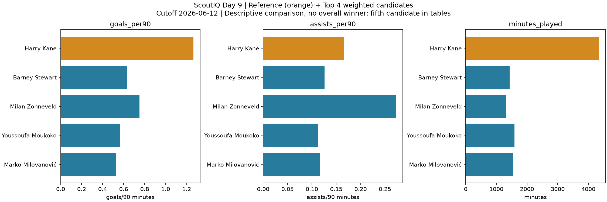

# Day 9 — Explainability & Player Comparison

20 responses khớp nguyên Day 8; 80 structured explanations. Không thay score/ranking/scaler/eligibility.
Snapshot 2025/26, cutoff 2026-06-12; fit 4.108/4.112 loại 4 query, không temporal split.
Evidence tách text; JSON sẵn cho tích hợp sau này, chưa gọi API. Không similarity-as-probability.

So sánh tối đa 5 người gồm reference + Top 4; người thứ 5 có pair riêng. Delta=candidate-reference; relative=100*delta/abs(reference), null nếu reference=0.

## young_low_budget_striker — Harry Kane

Status: ok; eligible=22.

| Rank | ID | Tên | EUR | Cosine |
|---|---|---|---:|---:|
| 1 | 1360186 | Barney Stewart | 1,000,000 | 0.956332 |
| 2 | 818445 | Milan Zonneveld | 450,000 | 0.926601 |
| 3 | 467720 | Youssoufa Moukoko | 5,000,000 | 0.915929 |
| 4 | 845568 | Marko Milovanović | 2,500,000 | 0.890610 |
| 5 | 670987 | Tawanda Maswanhise | 5,000,000 | 0.883390 |

- Barney Stewart (ID 1360186) so với Harry Kane: weighted_cosine=0.956332; không phải xác suất hoặc điểm kỹ năng. goals_per90: 0.6293706293706294 so với 1.2661439114391144 goals/90 minutes; chênh lệch có dấu -0.636773 goals/90 minutes. assists_per90: 0.1258741258741259 so với 0.1660516605166051 assists/90 minutes; chênh lệch có dấu -0.0401775 assists/90 minutes. sub_position: Centre-Forward / Centre-Forward; raw match=True. Market value=1000000.0 EUR; tuổi=22; phút=1430. Đạt 8 điều kiện cứng; định giá không là phí mua. Ưu tiên chân thuận chỉ phá hòa khi cosine bằng nhau, không thay score. Chỉ mô tả ghi bàn/kiến tạo và vai trò; thiếu xG, pressing và bối cảnh giải đấu.
- Milan Zonneveld (ID 818445) so với Harry Kane: weighted_cosine=0.926601; không phải xác suất hoặc điểm kỹ năng. goals_per90: 0.7505686125852918 so với 1.2661439114391144 goals/90 minutes; chênh lệch có dấu -0.515575 goals/90 minutes. assists_per90: 0.2729340409401061 so với 0.1660516605166051 assists/90 minutes; chênh lệch có dấu +0.106882 assists/90 minutes. sub_position: Centre-Forward / Centre-Forward; raw match=True. Market value=450000.0 EUR; tuổi=22; phút=1319. Đạt 8 điều kiện cứng; định giá không là phí mua. Ưu tiên chân thuận chỉ phá hòa khi cosine bằng nhau, không thay score. Chỉ mô tả ghi bàn/kiến tạo và vai trò; thiếu xG, pressing và bối cảnh giải đấu.
- Youssoufa Moukoko (ID 467720) so với Harry Kane: weighted_cosine=0.915929; không phải xác suất hoặc điểm kỹ năng. goals_per90: 0.5674653215636822 so với 1.2661439114391144 goals/90 minutes; chênh lệch có dấu -0.698679 goals/90 minutes. assists_per90: 0.1134930643127364 so với 0.1660516605166051 assists/90 minutes; chênh lệch có dấu -0.0525586 assists/90 minutes. sub_position: Centre-Forward / Centre-Forward; raw match=True. Market value=5000000.0 EUR; tuổi=21; phút=1586. Đạt 8 điều kiện cứng; định giá không là phí mua. Ưu tiên chân thuận chỉ phá hòa khi cosine bằng nhau, không thay score. Chỉ mô tả ghi bàn/kiến tạo và vai trò; thiếu xG, pressing và bối cảnh giải đấu.
- Marko Milovanović (ID 845568) so với Harry Kane: weighted_cosine=0.890610; không phải xác suất hoặc điểm kỹ năng. goals_per90: 0.5276872964169381 so với 1.2661439114391144 goals/90 minutes; chênh lệch có dấu -0.738457 goals/90 minutes. assists_per90: 0.1172638436482084 so với 0.1660516605166051 assists/90 minutes; chênh lệch có dấu -0.0487878 assists/90 minutes. sub_position: Centre-Forward / Centre-Forward; raw match=True. Market value=2500000.0 EUR; tuổi=22; phút=1535. Đạt 8 điều kiện cứng; định giá không là phí mua. Ưu tiên chân thuận chỉ phá hòa khi cosine bằng nhau, không thay score. Chỉ mô tả ghi bàn/kiến tạo và vai trò; thiếu xG, pressing và bối cảnh giải đấu.
- Tawanda Maswanhise (ID 670987) so với Harry Kane: weighted_cosine=0.883390; không phải xác suất hoặc điểm kỹ năng. goals_per90: 0.6245434623813002 so với 1.2661439114391144 goals/90 minutes; chênh lệch có dấu -0.6416 goals/90 minutes. assists_per90: 0.0657414170927684 so với 0.1660516605166051 assists/90 minutes; chênh lệch có dấu -0.10031 assists/90 minutes. sub_position: Centre-Forward / Centre-Forward; raw match=True. Market value=5000000.0 EUR; tuổi=23; phút=2738. Đạt 8 điều kiện cứng; định giá không là phí mua. Thiếu metadata ứng viên: foot; không suy đoán. Ưu tiên chân thuận chỉ phá hòa khi cosine bằng nhau, không thay score. Chỉ mô tả ghi bàn/kiến tạo và vai trò; thiếu xG, pressing và bối cảnh giải đấu.

So sánh (reference + Top 4; ID liên kết tên trong bảng/JSON):

| ID | Metric | Value | Reference | Signed delta | Relative % | Unit |
|---|---|---:|---:|---:|---:|---|
| 1360186 | age | 22 | 32 | -10 | -31.250 | years |
| 1360186 | minutes_played | 1430 | 4336 | -2906 | -67.020 | minutes |
| 1360186 | market_value_in_eur | 1e+06 | 6e+07 | -5.9e+07 | -98.333 | EUR |
| 1360186 | goals_per90 | 0.629371 | 1.26614 | -0.636773 | -50.292 | goals/90 minutes |
| 1360186 | assists_per90 | 0.125874 | 0.166052 | -0.0401775 | -24.196 | assists/90 minutes |
| 818445 | age | 22 | 32 | -10 | -31.250 | years |
| 818445 | minutes_played | 1319 | 4336 | -3017 | -69.580 | minutes |
| 818445 | market_value_in_eur | 450000 | 6e+07 | -5.955e+07 | -99.250 | EUR |
| 818445 | goals_per90 | 0.750569 | 1.26614 | -0.515575 | -40.720 | goals/90 minutes |
| 818445 | assists_per90 | 0.272934 | 0.166052 | 0.106882 | 64.367 | assists/90 minutes |
| 467720 | age | 21 | 32 | -11 | -34.375 | years |
| 467720 | minutes_played | 1586 | 4336 | -2750 | -63.423 | minutes |
| 467720 | market_value_in_eur | 5e+06 | 6e+07 | -5.5e+07 | -91.667 | EUR |
| 467720 | goals_per90 | 0.567465 | 1.26614 | -0.698679 | -55.182 | goals/90 minutes |
| 467720 | assists_per90 | 0.113493 | 0.166052 | -0.0525586 | -31.652 | assists/90 minutes |
| 845568 | age | 22 | 32 | -10 | -31.250 | years |
| 845568 | minutes_played | 1535 | 4336 | -2801 | -64.599 | minutes |
| 845568 | market_value_in_eur | 2.5e+06 | 6e+07 | -5.75e+07 | -95.833 | EUR |
| 845568 | goals_per90 | 0.527687 | 1.26614 | -0.738457 | -58.323 | goals/90 minutes |
| 845568 | assists_per90 | 0.117264 | 0.166052 | -0.0487878 | -29.381 | assists/90 minutes |

- Market value là ước tính tại snapshot, không phải phí chuyển nhượng hoặc kỹ năng.
- Phút/tuổi là bối cảnh; per90 chưa điều chỉnh giải đấu, chiến thuật hoặc bất định mẫu.
- Metadata CLB chưa được xác minh đúng tại cutoff; missing không được suy đoán.
- Không có kết luận cầu thủ tốt hơn tổng thể hoặc xác suất chuyển nhượng.
- Chỉ mô tả ghi bàn/kiến tạo và vai trò; thiếu xG, pressing và bối cảnh giải đấu.

## creative_midfielder — Hans Vanaken

Status: ok; eligible=10.

| Rank | ID | Tên | EUR | Cosine |
|---|---|---|---:|---:|
| 1 | 543302 | Jeppe Erenbjerg | 4,000,000 | 0.922962 |
| 2 | 1175048 | Robin van Cruijsen | 1,200,000 | 0.915103 |
| 3 | 652061 | Adam Karabec | 7,000,000 | 0.826067 |
| 4 | 896234 | Guillermo Balzi | 1,000,000 | 0.700985 |
| 5 | 485672 | Elijah Just | 2,500,000 | 0.671222 |

- Jeppe Erenbjerg (ID 543302) so với Hans Vanaken: weighted_cosine=0.922962; không phải xác suất hoặc điểm kỹ năng. goals_per90: 0.4214697406340058 so với 0.2290076335877862 goals/90 minutes; chênh lệch có dấu +0.192462 goals/90 minutes. assists_per90: 0.1621037463976945 so với 0.1335877862595419 assists/90 minutes; chênh lệch có dấu +0.028516 assists/90 minutes. sub_position: Attacking Midfield / Attacking Midfield; raw match=True. Market value=4000000.0 EUR; tuổi=26; phút=2776. Đạt 9 điều kiện cứng; định giá không là phí mua. Chỉ mô tả đóng góp tấn công; thiếu chuyền bóng, kiểm soát và phòng ngự.
- Robin van Cruijsen (ID 1175048) so với Hans Vanaken: weighted_cosine=0.915103; không phải xác suất hoặc điểm kỹ năng. goals_per90: 0.2535211267605634 so với 0.2290076335877862 goals/90 minutes; chênh lệch có dấu +0.0245135 goals/90 minutes. assists_per90: 0.1901408450704225 so với 0.1335877862595419 assists/90 minutes; chênh lệch có dấu +0.0565531 assists/90 minutes. sub_position: Attacking Midfield / Attacking Midfield; raw match=True. Market value=1200000.0 EUR; tuổi=20; phút=1420. Đạt 9 điều kiện cứng; định giá không là phí mua. Chỉ mô tả đóng góp tấn công; thiếu chuyền bóng, kiểm soát và phòng ngự.
- Adam Karabec (ID 652061) so với Hans Vanaken: weighted_cosine=0.826067; không phải xác suất hoặc điểm kỹ năng. goals_per90: 0.1929949964260185 so với 0.2290076335877862 goals/90 minutes; chênh lệch có dấu -0.0360126 goals/90 minutes. assists_per90: 0.1929949964260185 so với 0.1335877862595419 assists/90 minutes; chênh lệch có dấu +0.0594072 assists/90 minutes. sub_position: Attacking Midfield / Attacking Midfield; raw match=True. Market value=7000000.0 EUR; tuổi=22; phút=1399. Đạt 9 điều kiện cứng; định giá không là phí mua. Chỉ mô tả đóng góp tấn công; thiếu chuyền bóng, kiểm soát và phòng ngự.
- Guillermo Balzi (ID 896234) so với Hans Vanaken: weighted_cosine=0.700985; không phải xác suất hoặc điểm kỹ năng. goals_per90: 0.3280680437424058 so với 0.2290076335877862 goals/90 minutes; chênh lệch có dấu +0.0990604 goals/90 minutes. assists_per90: 0.3280680437424058 so với 0.1335877862595419 assists/90 minutes; chênh lệch có dấu +0.19448 assists/90 minutes. sub_position: Attacking Midfield / Attacking Midfield; raw match=True. Market value=1000000.0 EUR; tuổi=24; phút=1646. Đạt 9 điều kiện cứng; định giá không là phí mua. Chỉ mô tả đóng góp tấn công; thiếu chuyền bóng, kiểm soát và phòng ngự.
- Elijah Just (ID 485672) so với Hans Vanaken: weighted_cosine=0.671222; không phải xác suất hoặc điểm kỹ năng. goals_per90: 0.2629382303839733 so với 0.2290076335877862 goals/90 minutes; chênh lệch có dấu +0.0339306 goals/90 minutes. assists_per90: 0.3005008347245409 so với 0.1335877862595419 assists/90 minutes; chênh lệch có dấu +0.166913 assists/90 minutes. sub_position: Attacking Midfield / Attacking Midfield; raw match=True. Market value=2500000.0 EUR; tuổi=26; phút=2396. Đạt 9 điều kiện cứng; định giá không là phí mua. Chỉ mô tả đóng góp tấn công; thiếu chuyền bóng, kiểm soát và phòng ngự.

So sánh (reference + Top 4; ID liên kết tên trong bảng/JSON):

| ID | Metric | Value | Reference | Signed delta | Relative % | Unit |
|---|---|---:|---:|---:|---:|---|
| 543302 | age | 26 | 33 | -7 | -21.212 | years |
| 543302 | minutes_played | 2776 | 4716 | -1940 | -41.137 | minutes |
| 543302 | market_value_in_eur | 4e+06 | 5e+06 | -1e+06 | -20.000 | EUR |
| 543302 | goals_per90 | 0.42147 | 0.229008 | 0.192462 | 84.042 | goals/90 minutes |
| 543302 | assists_per90 | 0.162104 | 0.133588 | 0.028516 | 21.346 | assists/90 minutes |
| 1175048 | age | 20 | 33 | -13 | -39.394 | years |
| 1175048 | minutes_played | 1420 | 4716 | -3296 | -69.890 | minutes |
| 1175048 | market_value_in_eur | 1.2e+06 | 5e+06 | -3.8e+06 | -76.000 | EUR |
| 1175048 | goals_per90 | 0.253521 | 0.229008 | 0.0245135 | 10.704 | goals/90 minutes |
| 1175048 | assists_per90 | 0.190141 | 0.133588 | 0.0565531 | 42.334 | assists/90 minutes |
| 652061 | age | 22 | 33 | -11 | -33.333 | years |
| 652061 | minutes_played | 1399 | 4716 | -3317 | -70.335 | minutes |
| 652061 | market_value_in_eur | 7e+06 | 5e+06 | 2e+06 | 40.000 | EUR |
| 652061 | goals_per90 | 0.192995 | 0.229008 | -0.0360126 | -15.726 | goals/90 minutes |
| 652061 | assists_per90 | 0.192995 | 0.133588 | 0.0594072 | 44.471 | assists/90 minutes |
| 896234 | age | 24 | 33 | -9 | -27.273 | years |
| 896234 | minutes_played | 1646 | 4716 | -3070 | -65.098 | minutes |
| 896234 | market_value_in_eur | 1e+06 | 5e+06 | -4e+06 | -80.000 | EUR |
| 896234 | goals_per90 | 0.328068 | 0.229008 | 0.0990604 | 43.256 | goals/90 minutes |
| 896234 | assists_per90 | 0.328068 | 0.133588 | 0.19448 | 145.582 | assists/90 minutes |

- Market value là ước tính tại snapshot, không phải phí chuyển nhượng hoặc kỹ năng.
- Phút/tuổi là bối cảnh; per90 chưa điều chỉnh giải đấu, chiến thuật hoặc bất định mẫu.
- Metadata CLB chưa được xác minh đúng tại cutoff; missing không được suy đoán.
- Không có kết luận cầu thủ tốt hơn tổng thể hoặc xác suất chuyển nhượng.
- Chỉ mô tả đóng góp tấn công; thiếu chuyền bóng, kiểm soát và phòng ngự.

## experienced_defender — Virgil van Dijk

Status: ok; eligible=94.

| Rank | ID | Tên | EUR | Cosine |
|---|---|---|---:|---:|
| 1 | 236168 | Brandon Mechele | 2,800,000 | 0.999090 |
| 2 | 124502 | Matthias Ginter | 5,000,000 | 0.995862 |
| 3 | 244221 | Christian Burgess | 1,800,000 | 0.977334 |
| 4 | 187718 | Clinton Mata | 2,500,000 | 0.969863 |
| 5 | 173504 | James Tarkowski | 5,000,000 | 0.960660 |

- Brandon Mechele (ID 236168) so với Virgil van Dijk: weighted_cosine=0.999090; không phải xác suất hoặc điểm kỹ năng. age: 33 so với 34 years; chênh lệch có dấu -1 years. minutes_played: 4783 so với 4941 minutes; chênh lệch có dấu -158 minutes. sub_position: Centre-Back / Centre-Back; raw match=True. foot: right / right; raw match=True. Market value=2800000.0 EUR; tuổi=33; phút=4783. Đạt 8 điều kiện cứng; định giá không là phí mua. Chỉ tương đồng hồ sơ tuổi/thời lượng/vai trò/chân thuận; không đo năng lực phòng ngự.
- Matthias Ginter (ID 124502) so với Virgil van Dijk: weighted_cosine=0.995862; không phải xác suất hoặc điểm kỹ năng. age: 32 so với 34 years; chênh lệch có dấu -2 years. minutes_played: 4606 so với 4941 minutes; chênh lệch có dấu -335 minutes. sub_position: Centre-Back / Centre-Back; raw match=True. foot: right / right; raw match=True. Market value=5000000.0 EUR; tuổi=32; phút=4606. Đạt 8 điều kiện cứng; định giá không là phí mua. Chỉ tương đồng hồ sơ tuổi/thời lượng/vai trò/chân thuận; không đo năng lực phòng ngự.
- Christian Burgess (ID 244221) so với Virgil van Dijk: weighted_cosine=0.977334; không phải xác suất hoặc điểm kỹ năng. age: 34 so với 34 years; chênh lệch có dấu +0 years. minutes_played: 3957 so với 4941 minutes; chênh lệch có dấu -984 minutes. sub_position: Centre-Back / Centre-Back; raw match=True. foot: right / right; raw match=True. Market value=1800000.0 EUR; tuổi=34; phút=3957. Đạt 8 điều kiện cứng; định giá không là phí mua. Chỉ tương đồng hồ sơ tuổi/thời lượng/vai trò/chân thuận; không đo năng lực phòng ngự.
- Clinton Mata (ID 187718) so với Virgil van Dijk: weighted_cosine=0.969863; không phải xác suất hoặc điểm kỹ năng. age: 33 so với 34 years; chênh lệch có dấu -1 years. minutes_played: 3742 so với 4941 minutes; chênh lệch có dấu -1199 minutes. sub_position: Centre-Back / Centre-Back; raw match=True. foot: right / right; raw match=True. Market value=2500000.0 EUR; tuổi=33; phút=3742. Đạt 8 điều kiện cứng; định giá không là phí mua. Chỉ tương đồng hồ sơ tuổi/thời lượng/vai trò/chân thuận; không đo năng lực phòng ngự.
- James Tarkowski (ID 173504) so với Virgil van Dijk: weighted_cosine=0.960660; không phải xác suất hoặc điểm kỹ năng. age: 33 so với 34 years; chênh lệch có dấu -1 years. minutes_played: 3630 so với 4941 minutes; chênh lệch có dấu -1311 minutes. sub_position: Centre-Back / Centre-Back; raw match=True. foot: right / right; raw match=True. Market value=5000000.0 EUR; tuổi=33; phút=3630. Đạt 8 điều kiện cứng; định giá không là phí mua. Chỉ tương đồng hồ sơ tuổi/thời lượng/vai trò/chân thuận; không đo năng lực phòng ngự.

So sánh (reference + Top 4; ID liên kết tên trong bảng/JSON):

| ID | Metric | Value | Reference | Signed delta | Relative % | Unit |
|---|---|---:|---:|---:|---:|---|
| 236168 | age | 33 | 34 | -1 | -2.941 | years |
| 236168 | minutes_played | 4783 | 4941 | -158 | -3.198 | minutes |
| 236168 | market_value_in_eur | 2.8e+06 | 1.5e+07 | -1.22e+07 | -81.333 | EUR |
| 124502 | age | 32 | 34 | -2 | -5.882 | years |
| 124502 | minutes_played | 4606 | 4941 | -335 | -6.780 | minutes |
| 124502 | market_value_in_eur | 5e+06 | 1.5e+07 | -1e+07 | -66.667 | EUR |
| 244221 | age | 34 | 34 | 0 | 0.000 | years |
| 244221 | minutes_played | 3957 | 4941 | -984 | -19.915 | minutes |
| 244221 | market_value_in_eur | 1.8e+06 | 1.5e+07 | -1.32e+07 | -88.000 | EUR |
| 187718 | age | 33 | 34 | -1 | -2.941 | years |
| 187718 | minutes_played | 3742 | 4941 | -1199 | -24.266 | minutes |
| 187718 | market_value_in_eur | 2.5e+06 | 1.5e+07 | -1.25e+07 | -83.333 | EUR |

- Market value là ước tính tại snapshot, không phải phí chuyển nhượng hoặc kỹ năng.
- Phút/tuổi là bối cảnh; per90 chưa điều chỉnh giải đấu, chiến thuật hoặc bất định mẫu.
- Metadata CLB chưa được xác minh đúng tại cutoff; missing không được suy đoán.
- Không có kết luận cầu thủ tốt hơn tổng thể hoặc xác suất chuyển nhượng.
- Chỉ tương đồng hồ sơ tuổi/thời lượng/vai trò/chân thuận; không đo năng lực phòng ngự.

## budget_goalkeeper — Lukas Hornicek

Status: ok; eligible=47.

| Rank | ID | Tên | EUR | Cosine |
|---|---|---|---:|---:|
| 1 | 464373 | Elías Ólafsson | 3,000,000 | 0.863745 |
| 2 | 403564 | Jon McCracken | 500,000 | 0.863250 |
| 3 | 338665 | Brent Gabriël | 1,000,000 | 0.860127 |
| 4 | 337290 | Shamal George | 300,000 | 0.823090 |
| 5 | 360338 | Marcos Peano | 2,000,000 | 0.812324 |

- Elías Ólafsson (ID 464373) so với Lukas Hornicek: weighted_cosine=0.863745; không phải xác suất hoặc điểm kỹ năng. age: 26 so với 23 years; chênh lệch có dấu +3 years. minutes_played: 3182 so với 4970 minutes; chênh lệch có dấu -1788 minutes. foot: right / right; raw match=True. Market value=3000000.0 EUR; tuổi=26; phút=3182. Đạt 8 điều kiện cứng; định giá không là phí mua. Chỉ tương đồng hồ sơ tuổi/thời lượng/chân thuận; không đo bắt bóng, không dùng bàn thắng.
- Jon McCracken (ID 403564) so với Lukas Hornicek: weighted_cosine=0.863250; không phải xác suất hoặc điểm kỹ năng. age: 26 so với 23 years; chênh lệch có dấu +3 years. minutes_played: 3180 so với 4970 minutes; chênh lệch có dấu -1790 minutes. foot: right / right; raw match=True. Market value=500000.0 EUR; tuổi=26; phút=3180. Đạt 8 điều kiện cứng; định giá không là phí mua. Chỉ tương đồng hồ sơ tuổi/thời lượng/chân thuận; không đo bắt bóng, không dùng bàn thắng.
- Brent Gabriël (ID 338665) so với Lukas Hornicek: weighted_cosine=0.860127; không phải xác suất hoặc điểm kỹ năng. age: 27 so với 23 years; chênh lệch có dấu +4 years. minutes_played: 3240 so với 4970 minutes; chênh lệch có dấu -1730 minutes. foot: right / right; raw match=True. Market value=1000000.0 EUR; tuổi=27; phút=3240. Đạt 8 điều kiện cứng; định giá không là phí mua. Chỉ tương đồng hồ sơ tuổi/thời lượng/chân thuận; không đo bắt bóng, không dùng bàn thắng.
- Shamal George (ID 337290) so với Lukas Hornicek: weighted_cosine=0.823090; không phải xác suất hoặc điểm kỹ năng. age: 28 so với 23 years; chênh lệch có dấu +5 years. minutes_played: 3218 so với 4970 minutes; chênh lệch có dấu -1752 minutes. foot: right / right; raw match=True. Market value=300000.0 EUR; tuổi=28; phút=3218. Đạt 8 điều kiện cứng; định giá không là phí mua. Chỉ tương đồng hồ sơ tuổi/thời lượng/chân thuận; không đo bắt bóng, không dùng bàn thắng.
- Marcos Peano (ID 360338) so với Lukas Hornicek: weighted_cosine=0.812324; không phải xác suất hoặc điểm kỹ năng. age: 27 so với 23 years; chênh lệch có dấu +4 years. minutes_played: 3060 so với 4970 minutes; chênh lệch có dấu -1910 minutes. foot: right / right; raw match=True. Market value=2000000.0 EUR; tuổi=27; phút=3060. Đạt 8 điều kiện cứng; định giá không là phí mua. Chỉ tương đồng hồ sơ tuổi/thời lượng/chân thuận; không đo bắt bóng, không dùng bàn thắng.

So sánh (reference + Top 4; ID liên kết tên trong bảng/JSON):

| ID | Metric | Value | Reference | Signed delta | Relative % | Unit |
|---|---|---:|---:|---:|---:|---|
| 464373 | age | 26 | 23 | 3 | 13.043 | years |
| 464373 | minutes_played | 3182 | 4970 | -1788 | -35.976 | minutes |
| 464373 | market_value_in_eur | 3e+06 | 1.8e+07 | -1.5e+07 | -83.333 | EUR |
| 403564 | age | 26 | 23 | 3 | 13.043 | years |
| 403564 | minutes_played | 3180 | 4970 | -1790 | -36.016 | minutes |
| 403564 | market_value_in_eur | 500000 | 1.8e+07 | -1.75e+07 | -97.222 | EUR |
| 338665 | age | 27 | 23 | 4 | 17.391 | years |
| 338665 | minutes_played | 3240 | 4970 | -1730 | -34.809 | minutes |
| 338665 | market_value_in_eur | 1e+06 | 1.8e+07 | -1.7e+07 | -94.444 | EUR |
| 337290 | age | 28 | 23 | 5 | 21.739 | years |
| 337290 | minutes_played | 3218 | 4970 | -1752 | -35.252 | minutes |
| 337290 | market_value_in_eur | 300000 | 1.8e+07 | -1.77e+07 | -98.333 | EUR |

- Market value là ước tính tại snapshot, không phải phí chuyển nhượng hoặc kỹ năng.
- Phút/tuổi là bối cảnh; per90 chưa điều chỉnh giải đấu, chiến thuật hoặc bất định mẫu.
- Metadata CLB chưa được xác minh đúng tại cutoff; missing không được suy đoán.
- Không có kết luận cầu thủ tốt hơn tổng thể hoặc xác suất chuyển nhượng.
- Chỉ tương đồng hồ sơ tuổi/thời lượng/chân thuận; không đo bắt bóng, không dùng bàn thắng.

## no_results — Harry Kane

Status: no_candidates; eligible=0.

| Rank | ID | Tên | EUR | Cosine |
|---|---|---|---:|---:|

Không có ứng viên: explanations/comparisons rỗng, không thêm cầu thủ hoặc nới constraints.

- Market value là ước tính tại snapshot, không phải phí chuyển nhượng hoặc kỹ năng.
- Phút/tuổi là bối cảnh; per90 chưa điều chỉnh giải đấu, chiến thuật hoặc bất định mẫu.
- Metadata CLB chưa được xác minh đúng tại cutoff; missing không được suy đoán.
- Không có kết luận cầu thủ tốt hơn tổng thể hoặc xác suất chuyển nhượng.
- Chỉ mô tả ghi bàn/kiến tạo và vai trò; thiếu xG, pressing và bối cảnh giải đấu.

## Biểu đồ

## Giới hạn và Day 10

Không tổng hợp thành điểm chất lượng, không causal attribution. Defender/GK và mixed positions chỉ so context.
Metadata CLB/foot thiếu, league effects và temporal validity còn hạn chế. Day 10 dự kiến tích hợp recommendation engine; chưa triển khai.
